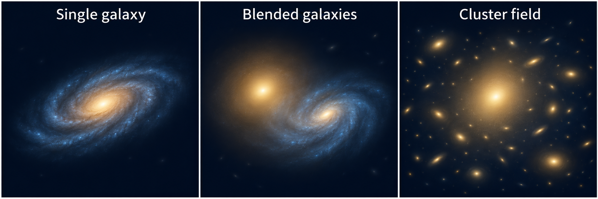

(overview-2-new-user-guide)=

# New User Guide

**PyAutoGalaxy** models the light of galaxies, from an individual galaxy to blended systems and crowded cluster fields. Your starting example depends on which galaxies you need to model together and the observations you want to analyse.

The **autogalaxy_workspace** contains Jupyter Notebooks that introduce the modelling workflow using example datasets, with Python code you can read, run and adapt. Start by choosing the galaxy system below, then your dataset type where appropriate. You can explore an example before preparing your own data.

If you would like help along the way, describe your galaxies and observations to the [PyAutoGalaxy AI Assistant](https://github.com/PyAutoLabs/autogalaxy_assistant). It can suggest a starting notebook, explain the code and help you adapt the example to your science case.

(what-scale-system)=

## Which galaxies need modelling?

Start with the galaxies whose light contributes to the region you want to analyse. You might be studying one galaxy, separating the overlapping light of neighbours, or modelling many galaxies across a cluster field.

The choice depends on which objects need to be fitted together, rather than simply how many appear in the image. For a single galaxy, continue to the dataset choices below. The other cards take you straight to their starting notebooks.

*AI-generated conceptual illustration, not observations or fitted models. Panels are not shown at the same angular scale.*

::::{grid} 1 1 3 3
:gutter: 3

:::{grid-item-card} Single galaxy
One galaxy is the target of your analysis.

[Choose your data type below](#what-dataset-type)
:::

:::{grid-item-card} Blended galaxies
Two or more galaxies have overlapping light.

[Notebook](https://github.com/PyAutoLabs/autogalaxy_workspace/blob/main/notebooks/multi_galaxy/start_here.ipynb) · [Google Colab](https://colab.research.google.com/github/PyAutoLabs/autogalaxy_workspace/blob/2026.11.13.1/notebooks/multi_galaxy/start_here.ipynb)
:::

:::{grid-item-card} Cluster field
A bright central galaxy and surrounding cluster members.

[Notebook](https://github.com/PyAutoLabs/autogalaxy_workspace/blob/main/notebooks/cluster/start_here.ipynb) · [Google Colab](https://colab.research.google.com/github/PyAutoLabs/autogalaxy_workspace/blob/2026.11.13.1/notebooks/cluster/start_here.ipynb)
:::

::::

These examples model the galaxies’ own light, including in cluster fields. If your goal is to model gravitational lensing and the distorted images of background sources, start with [PyAutoLens](https://pyautolens.readthedocs.io/en/latest/overview/overview_2_new_user_guide.html).

(what-dataset-type)=

## What dataset type?

For a single galaxy, choose the notebook that matches your observations. A telescope image, interferometer measurements and images taken in several wavebands each call for a different starting workflow.

Each notebook begins with example data and introduces the relevant model and fitting steps. If you do not have your own dataset yet, choose the example closest to your interests. For blended galaxies or cluster fields, begin with the system-specific guide above.

::::{grid} 1 1 3 3
:gutter: 3

:::{grid-item-card} Imaging

Galaxy images from Hubble, JWST or ground-based telescopes.

[Notebook](https://github.com/PyAutoLabs/autogalaxy_workspace/blob/main/notebooks/imaging/start_here.ipynb) · [Google Colab](https://colab.research.google.com/github/PyAutoLabs/autogalaxy_workspace/blob/2026.11.13.1/notebooks/imaging/start_here.ipynb)
:::

:::{grid-item-card} Interferometer

Radio or submillimetre observations, such as ALMA visibilities.

[Notebook](https://github.com/PyAutoLabs/autogalaxy_workspace/blob/main/notebooks/interferometer/start_here.ipynb) · [Google Colab](https://colab.research.google.com/github/PyAutoLabs/autogalaxy_workspace/blob/2026.11.13.1/notebooks/interferometer/start_here.ipynb)
:::

:::{grid-item-card} Multi-band imaging

Images of the same galaxy in several wavebands.

[Notebook](https://github.com/PyAutoLabs/autogalaxy_workspace/blob/main/notebooks/multi_dataset/start_here.ipynb) · [Google Colab](https://colab.research.google.com/github/PyAutoLabs/autogalaxy_workspace/blob/2026.11.13.1/notebooks/multi_dataset/start_here.ipynb)
:::

::::

Combining wavebands can help you study colour gradients and how a galaxy’s apparent structure changes with wavelength. The multi-band example introduces fitting those observations together.

(google-colab)=

## Open and run an example

The **Notebook** links open a readable preview on GitHub. You can browse the explanations and code there before deciding which example to try.

To run an example in your browser, choose **Google Colab**. Run its setup cell first to install the software and prepare the example, then work through the notebook in order. This lets you try PyAutoGalaxy without setting up a local installation.

If you already have PyAutoGalaxy installed and a local copy of the workspace, open the same notebook in Jupyter on your machine. Start with the supplied dataset so you can follow the complete workflow, then adapt it to your own observations.

## Still unsure?

You do not need to settle every modelling choice before getting started. Browse the introductions to a couple of notebooks and choose the one closest to your galaxies and observations. The starting examples establish the workflow; more specialised choices can come later.

You can also tell the [AI Assistant](https://github.com/PyAutoLabs/autogalaxy_assistant) which galaxies overlap in your field, what data you have and what you hope to measure. It can help you find the most relevant example.

(howtogalaxy)=

## Learn the science

The starting examples introduce how to use PyAutoGalaxy. If galaxy light profiles or Bayesian modelling are new to you, you may also want a slower explanation of how these models describe galaxy structure and how their parameters are inferred from data.

[HowToGalaxy](https://github.com/PyAutoLabs/HowToGalaxy) develops these ideas through worked Jupyter Notebooks. It is particularly useful for students and researchers beginning galaxy modelling, and you can work through it alongside the workspace examples.

If you already know the underlying science, begin with the example for your observations and return to HowToGalaxy whenever you want more background.

(wrap-up)=

## Next steps

First, work through your chosen starting notebook and become familiar with its data, model and results. Then explore the [Features guide](https://pyautogalaxy.readthedocs.io/en/latest/overview/overview_3_features.html) for additional modelling tools suited to your science, with links to detailed introductions and worked examples.
