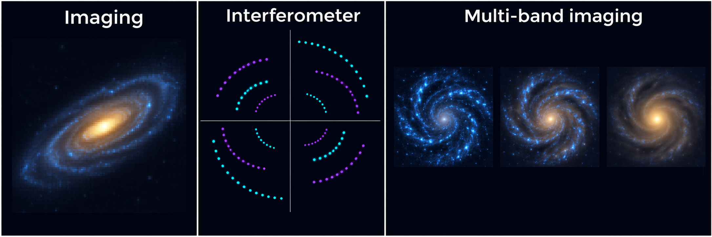

(overview-2-new-user-guide)=

# New User Guide

This guide helps you choose a **PyAutoGalaxy example notebook** for your observations. Start with the galaxies you need to model together, then choose your data type. Each example includes Python code you can read, run and adapt.

If you use AI, describe your galaxies and observations to the [PyAutoGalaxy AI Assistant](https://github.com/PyAutoLabs/autogalaxy_assistant). It can help you choose an example and work through it interactively.

(what-scale-system)=

## Which galaxies need modelling?

Choose an example based on how much their light overlaps and how many galaxies you need to fit together.

*AI-generated conceptual illustration, not observations or fitted models. Panels are not shown at the same angular scale.*

::::{grid} 1 1 3 3
:gutter: 3

:::{grid-item-card} Single galaxy
One galaxy is the target. Mask unrelated neighbours whose light does not need to be modelled jointly. Start with your data type below.

[Choose your data type below](#what-dataset-type)
:::

:::{grid-item-card} Blended galaxies
Two or more galaxies have overlapping light. Fit a separate light model for each galaxy at the same time.

[Notebook ](https://github.com/PyAutoLabs/autogalaxy_workspace/blob/main/notebooks/multi_galaxy/start_here.ipynb)·[Google Colab ](https://colab.research.google.com/github/PyAutoLabs/autogalaxy_workspace/blob/2026.11.12.1/notebooks/multi_galaxy/start_here.ipynb)
:::

:::{grid-item-card} Cluster field
Model a bright central galaxy and a catalogue of member galaxies. The example uses catalogue photometry to constrain fainter members and reduce the number of free parameters.

[Notebook ](https://github.com/PyAutoLabs/autogalaxy_workspace/blob/main/notebooks/cluster/start_here.ipynb)·[Google Colab ](https://colab.research.google.com/github/PyAutoLabs/autogalaxy_workspace/blob/2026.11.12.1/notebooks/cluster/start_here.ipynb)
:::

::::

This cluster example models the galaxies’ light. For strong-lensing mass models and background-source images, use [PyAutoLens](https://pyautolens.readthedocs.io/en/latest/overview/overview_2_new_user_guide.html).

(what-dataset-type)=

## What dataset type?

For a single galaxy, choose the example for your observations. For blended galaxies or cluster fields, begin with the system-specific guide above.

*AI-generated schematic, not measured data. The interferometer panel shows sampling locations; multi-band images illustrate how the relative prominence of a galaxy’s components can change with wavelength.*

::::{grid} 1 1 3 3
:gutter: 3

:::{grid-item-card} Imaging
Images from Hubble, JWST or ground-based telescopes. Model the distribution of starlight using light profiles.

[Notebook ](https://github.com/PyAutoLabs/autogalaxy_workspace/blob/main/notebooks/imaging/start_here.ipynb)·[Google Colab ](https://colab.research.google.com/github/PyAutoLabs/autogalaxy_workspace/blob/2026.11.12.1/notebooks/imaging/start_here.ipynb)
:::

:::{grid-item-card} Interferometer
Radio or submillimetre observations, such as ALMA data. Fit the measured visibilities directly.

[Notebook ](https://github.com/PyAutoLabs/autogalaxy_workspace/blob/main/notebooks/interferometer/start_here.ipynb)·[Google Colab ](https://colab.research.google.com/github/PyAutoLabs/autogalaxy_workspace/blob/2026.11.12.1/notebooks/interferometer/start_here.ipynb)
:::

:::{grid-item-card} Multi-band imaging
Images of the same galaxy in several wavebands. Fit them together to study colour gradients and wavelength-dependent structure.

[Notebook ](https://github.com/PyAutoLabs/autogalaxy_workspace/blob/main/notebooks/multi_dataset/start_here.ipynb)·[Google Colab ](https://colab.research.google.com/github/PyAutoLabs/autogalaxy_workspace/blob/2026.11.12.1/notebooks/multi_dataset/start_here.ipynb)
:::

::::

(google-colab)=

Read each notebook on GitHub, open it locally, or use its Google Colab link to run it in your browser. In Colab, run the setup cell first to install the software and prepare the example.

## Still unsure?

Tell the [AI Assistant](https://github.com/PyAutoLabs/autogalaxy_assistant) which galaxies overlap in your field and what observations you have. It can help you identify a starting example.

(howtogalaxy)=

## Learn the science

[HowToGalaxy](https://github.com/PyAutoLabs/HowToGalaxy) teaches galaxy structure and Bayesian modelling through worked notebooks. Use it for a slower explanation of the concepts behind these examples.

(wrap-up)=

## Next steps

Once you have chosen an example, explore the [Features guide](https://pyautogalaxy.readthedocs.io/en/latest/overview/overview_3_features.html) to find the modelling tools relevant to your science.
