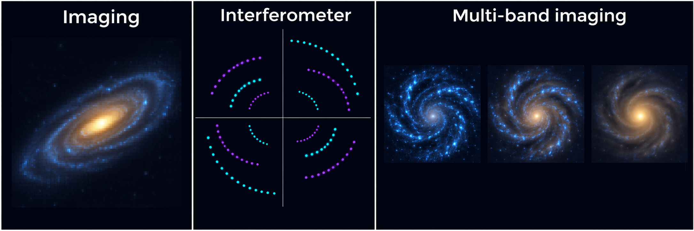
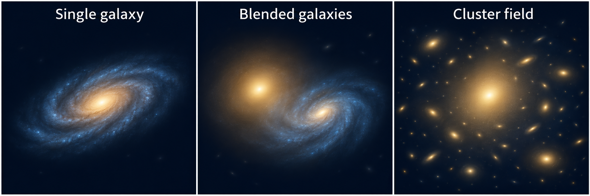
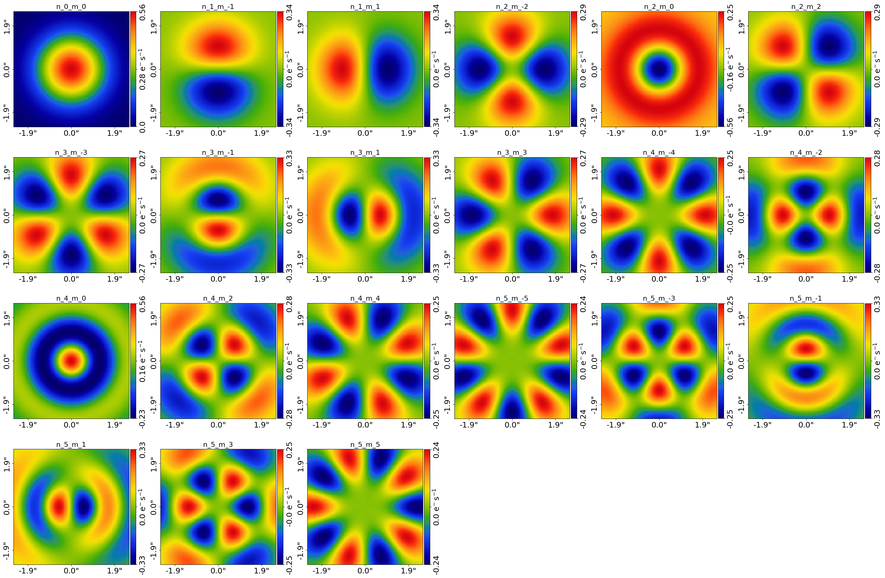

(overview-3-features)=

# Features

This page provides an overview of the advanced features of **PyAutoGalaxy**.

Firstly, brief one sentence descriptions of each feature are given, with more detailed descriptions below including
links to the relevant workspace examples.

**Linear Light Profiles**: Solve brightnesses while sampling galaxy geometry.

**Extra Galaxies**: Model neighbouring light that overlaps the target.

**Point Source**: Simulate unresolved nuclear emission in an extended host.

**Interferometry**: Modeling of interferometer data (e.g. ALMA, LOFAR) directly in the uv-plane.

**Multi-Wavelength**: Simultaneous analysis of imaging and / or interferometer datasets observed at different wavelengths.

**Ellipse Fitting**: Fitting ellipses to determine a galaxy's ellipticity, position angle and centre.

**Multi Gaussian Expansion (MGE)**: Describe central and extended galaxy light with a flexible sum of Gaussian components.

**Shapelets**: Decomposing a galaxy into a set of shapelet orthogonal basis functions, capturing more complex structures than simple light profiles.

**Sky Background**: Fit uncertain sky levels alongside faint galaxy outskirts.

**Operated Light Profiles**: Fit compact imaging emission whose profile already includes its PSF response.

**Pixelizations**: Reconstruct irregular galaxy light on a regularized mesh.

## Interferometry

Study the radio and submillimeter structure of galaxies by modeling interferometer data from submillimeter (e.g. ALMA) and radio (e.g. LOFAR) observatories:

```{image} https://raw.githubusercontent.com/PyAutoLabs/PyAutoGalaxy/main/paper/almacombined.png
:alt: Alternative text
:width: 600
```

Visibilities data is fitted directly in the uv-plane, circumventing issues that arise when fitting a dirty image
such as correlated noise. This uses the non-uniform fast fourier transform algorithm
\[nufftax\](<https://github.com/GragasLab/nufftax>) to efficiently map the galaxy model images to the uv-plane.

Checkout the `autogalaxy_workspace/*/interferometer` package to get started.

For flexible galaxy-light modeling, see [MGE](https://github.com/PyAutoLabs/autogalaxy_workspace/blob/main/notebooks/interferometer/features/multi_gaussian_expansion/start_here.ipynb) and [pixelization](https://github.com/PyAutoLabs/autogalaxy_workspace/blob/main/notebooks/interferometer/features/pixelization/start_here.ipynb).
Inspect the sky reconstruction as well as the visibility fit; a dirty image is not the likelihood dataset.


## Multi-Wavelength

Modeling imaging datasets observed at different wavelengths (e.g. HST F814W and F150W) simultaneously or simultaneously
analysing imaging and interferometer data:

```{image} https://raw.githubusercontent.com/PyAutoLabs/PyAutoGalaxy/main/docs/overview/images/overview_3/g_image.png
:alt: Alternative text
:width: 400
```

```{image} https://raw.githubusercontent.com/PyAutoLabs/PyAutoGalaxy/main/docs/overview/images/overview_3/r_image.png
:alt: Alternative text
:width: 400
```

The appearance of the galaxy changes as a function of wavelength, therefore multi-wavelength analysis means we can learn
more about the different components in a galaxy (e.g a redder bulge and bluer disk) or when imaging and interferometer
data are combined, we can compare the emission from stars and dust.

Checkout the `autogalaxy_workspace/*/multi_dataset` package to get started, however combining datasets is a more advanced
feature and it is recommended you first get to grips with the core API.



Reused new-user-guide schematic, not observed data. Visibility sampling positions are distinct from
measured amplitudes, and separate bands need not share the same light distribution.

Use [wavelength dependence](https://github.com/PyAutoLabs/autogalaxy_workspace/blob/main/notebooks/multi_dataset/features/wavelength_dependence/start_here.ipynb) for linked bulge and disk radii, [pixelization](https://github.com/PyAutoLabs/autogalaxy_workspace/blob/main/notebooks/multi_dataset/features/pixelization/start_here.ipynb) for per-band
light reconstructions, or [imaging and interferometer](https://github.com/PyAutoLabs/autogalaxy_workspace/blob/main/notebooks/multi_dataset/features/imaging_and_interferometer/start_here.ipynb) for complementary emission.
The [one-by-one example](https://github.com/PyAutoLabs/autogalaxy_workspace/blob/main/notebooks/multi_dataset/features/one_by_one/start_here.ipynb) shows parameter transfer; fixing an earlier estimate does not propagate its full uncertainty.


## Ellipse Fitting

Ellipse fitting is a technique which fits many ellipses to a galaxy's emission to determine its ellipticity, position
angle and centre, without assuming a parametric form for its light (e.g. a Sersic profile):

```{image} https://raw.githubusercontent.com/PyAutoLabs/PyAutoGalaxy/main/docs/overview/images/overview_3/ellipse.png
:alt: Alternative text
:width: 600
```

This provides complementary information to parametric light profile fitting, for example giving insights on whether
the ellipticity and position angle are constant with radius or if the galaxy's emission is lopsided.

There are also multipole moment extensions to ellipse fitting, which determine higher order deviations from elliptical
symmetry providing even more information on the galaxy's structure.

The following paper describes the technique in detail: <https://arxiv.org/html/2407.12983v1>

Checkout `autogalaxy_workspace/notebooks/features/ellipse_fitting.ipynb` to learn how to use ellipse fitting.

## Linear Light Profiles

Fit galaxy structure with fewer sampled parameters by solving component brightnesses at every likelihood evaluation. This is especially useful for bulge–disk decomposition and models containing many overlapping light components: the search explores their geometry while their intensities are solved together.


Conceptual illustration: the paths symbolize different sampled parameter spaces, not measured convergence rates or removal of physical degeneracies.

Read the [feature introduction](https://github.com/PyAutoLabs/autogalaxy_workspace/blob/main/notebooks/imaging/features/linear_light_profiles/start_here.ipynb) for the scientific use cases,
model assumptions and worked-example routes.

## Extra Galaxies

Measure a target galaxy's light in a crowded field by modeling the neighbouring galaxies whose emission overlaps the fitted region. Separating those contributions helps protect the target's inferred size, shape and flux from contamination.



Reused new-user-guide schematic: these are light-modeling environments, not gravitational-lensing mass models.

See [the imaging introduction](https://github.com/PyAutoLabs/autogalaxy_workspace/blob/main/notebooks/imaging/features/extra_galaxies/start_here.ipynb) and [the multi-galaxy introduction](https://github.com/PyAutoLabs/autogalaxy_workspace/blob/main/notebooks/multi_galaxy/features/extra_galaxies/start_here.ipynb) for component choices and fixed-centre companions.

## Point Source

Explore how an unresolved nucleus contributes to a galaxy image and affects measurements of its extended host. The point-source component supplies a position and flux; the instrumental response determines its observed footprint.


Conceptual illustration of added unresolved nuclear emission. The bright footprint is set by the response; it does not resolve the intrinsic nucleus.

Read the [feature introduction](https://github.com/PyAutoLabs/autogalaxy_workspace/blob/main/notebooks/imaging/features/point_source/start_here.ipynb) for the scientific use cases,
model assumptions and worked-example routes.

The point-source folder currently supplies a simulator, not a complete inference workflow. It demonstrates
an unresolved nuclear component in an extended host; the PSF determines its observed footprint.

## Multi Gaussian Expansion (MGE)

Describe a galaxy's central light and extended envelope with a flexible sum of Gaussian profiles. An MGE is useful when one simple profile leaves structured residuals, or when you need a smooth light model from which to measure the combined luminosity and radial structure.


Conceptual illustration: the displayed Gaussians are components of one light model. The inset is a decomposition, not a spatial magnification of the galaxy core.

Read the [feature introduction](https://github.com/PyAutoLabs/autogalaxy_workspace/blob/main/notebooks/imaging/features/multi_gaussian_expansion/start_here.ipynb) for the scientific use cases,
model assumptions and worked-example routes.

The teaching figures below show the Gaussian components and their model structure. Narrow basis widths
can represent compact light; they do not establish spatial resolution finer than the data support. The model
solves component intensities rather than sampling them individually.

```{image} https://raw.githubusercontent.com/PyAutoLabs/PyAutoGalaxy/main/docs/overview/images/overview_3/mge.png
:alt: Alternative text
:width: 600
```

```{image} https://raw.githubusercontent.com/PyAutoLabs/PyAutoGalaxy/main/docs/overview/images/overview_3/mge_model.png
:alt: The MGE galaxy model, whose sixty Gaussians are drawn as two plates of thirty components.
:width: 600
```


## Shapelets

Describe departures from a smooth galaxy profile with a flexible set of spatial basis functions. Shapelets are useful for studying asymmetric morphology and structured residuals while retaining a compact parameterization of the basis geometry.


Reused conceptual illustration. “Source model” here means the emitting galaxy; there is no gravitational-lensing source plane. The summed basis represents light, not separate physical structures.

Read the [feature introduction](https://github.com/PyAutoLabs/autogalaxy_workspace/blob/main/notebooks/imaging/features/shapelets/start_here.ipynb) for the scientific use cases,
model assumptions and worked-example routes.



Keep the basis grid alongside the conceptual illustration. Signed basis coefficients need not imply
negative total light; inspect the sum. The basis order, scale and shared geometry determine its flexibility.


## Sky Background

Measure faint galaxy outskirts while fitting an uncertain sky level alongside the galaxy light. This is useful for retained backgrounds and residual sky-subtraction offsets, where a small background error can otherwise alter the inferred size or outer profile.


Conceptual illustration: the separated layers are additive light and background components, not physical planes in space.

Read the [feature introduction](https://github.com/PyAutoLabs/autogalaxy_workspace/blob/main/notebooks/imaging/features/sky_background/start_here.ipynb) for the scientific use cases,
model assumptions and worked-example routes.

The example fits a constant sky level. Fitting its mean does not remove photon noise. The supplied
simulation uses 5.0 electrons per second, at the upper edge of the example prior [0.0, 5.0]; choose
appropriate bounds when adapting the analysis.


## Operated Light Profiles

Separate compact nuclear emission from an extended host using a profile whose imaging PSF response is already included. This is useful when the component you want to fit describes the observed compact glow, rather than an intrinsic light distribution that still needs to be blurred.


Conceptual illustration of the imaging response: the compact component already includes its PSF blur. The extended galaxy is still treated with its appropriate response.

Read the [feature introduction](https://github.com/PyAutoLabs/autogalaxy_workspace/blob/main/notebooks/imaging/features/operated_light_profile/start_here.ipynb) for the scientific use cases,
model assumptions and worked-example routes.

This PSF interpretation applies to imaging. In the [interferometer example](https://github.com/PyAutoLabs/autogalaxy_workspace/blob/main/notebooks/interferometer/features/operated_light_profile/start_here.ipynb),
the compact sky profile is Fourier transformed into visibilities; there is no imaging PSF convolution to bypass.


## Pixelizations

Reconstruct galaxy light that is difficult to describe with a small set of analytic profiles, such as asymmetric or clumpy emission. A pixelization solves brightness on a mesh, allowing the morphology of the emission to be studied while accounting for the observation's response and noise.


Conceptual illustration, not a fitted reconstruction. The two views represent the same galaxy brightness; the schematic triangular overlay is not a claim about the mesh used in every example.

Read the [feature introduction](https://github.com/PyAutoLabs/autogalaxy_workspace/blob/main/notebooks/imaging/features/pixelization/start_here.ipynb) for the scientific use cases,
model assumptions and worked-example routes.

Start with the smooth-bulge-plus-pixelized-light imaging example for irregular galaxy emission. The
linked galaxy_reconstruction.py shows how to inspect and export the inferred light. Regularization and
mesh choices affect what structure the data can support.

The existing Hubble Ultra Deep Field teaching figure illustrates a combined parametric and pixelized model:

```{image} https://raw.githubusercontent.com/PyAutoLabs/PyAutoGalaxy/main/paper/hstcombined.png
:alt: Combined light-profile and pixelized reconstruction of galaxy emission.
:width: 600
```


## Graphical Models

The examples above fit each galaxy dataset one-by-one. However, many galaxy properties are shared across a
sample (e.g. the population's distribution of Sersic indices or sizes), and fitting galaxies independently does
not exploit this shared structure.

Graphical models fit multiple datasets simultaneously, explicitly defining which parameters are unique to each
galaxy and which are shared across the sample. Hierarchical extensions assume parameters are drawn from a parent
distribution, whose properties are inferred from the full sample, extracting significantly more information
than one-by-one fitting. This is a powerful tool for galaxy evolution studies of large samples, for example
measuring how the galaxy population's structural properties vary with mass or redshift.

Checkout `autofit_workspace/*/features/graphical_models.py` to learn how to compose and fit a graphical model;
the API applies directly to the galaxy fits shown throughout this workspace.

## Choose a Feature by Dataset

Each introduction below explains the scientific use cases, teaching concepts and example-specific choices.

### Imaging

- [Extra Galaxies](https://github.com/PyAutoLabs/autogalaxy_workspace/blob/main/notebooks/imaging/features/extra_galaxies/start_here.ipynb)
- [Linear Light Profiles](https://github.com/PyAutoLabs/autogalaxy_workspace/blob/main/notebooks/imaging/features/linear_light_profiles/start_here.ipynb)
- [Multi Gaussian Expansion](https://github.com/PyAutoLabs/autogalaxy_workspace/blob/main/notebooks/imaging/features/multi_gaussian_expansion/start_here.ipynb)
- [Operated Light Profile](https://github.com/PyAutoLabs/autogalaxy_workspace/blob/main/notebooks/imaging/features/operated_light_profile/start_here.ipynb)
- [Pixelization](https://github.com/PyAutoLabs/autogalaxy_workspace/blob/main/notebooks/imaging/features/pixelization/start_here.ipynb)
- [Point Source](https://github.com/PyAutoLabs/autogalaxy_workspace/blob/main/notebooks/imaging/features/point_source/start_here.ipynb)
- [Shapelets](https://github.com/PyAutoLabs/autogalaxy_workspace/blob/main/notebooks/imaging/features/shapelets/start_here.ipynb)
- [Sky Background](https://github.com/PyAutoLabs/autogalaxy_workspace/blob/main/notebooks/imaging/features/sky_background/start_here.ipynb)

### Interferometer

- [Extra Galaxies](https://github.com/PyAutoLabs/autogalaxy_workspace/blob/main/notebooks/interferometer/features/extra_galaxies/start_here.ipynb)
- [Linear Light Profiles](https://github.com/PyAutoLabs/autogalaxy_workspace/blob/main/notebooks/interferometer/features/linear_light_profiles/start_here.ipynb)
- [Multi Gaussian Expansion](https://github.com/PyAutoLabs/autogalaxy_workspace/blob/main/notebooks/interferometer/features/multi_gaussian_expansion/start_here.ipynb)
- [Operated Light Profile](https://github.com/PyAutoLabs/autogalaxy_workspace/blob/main/notebooks/interferometer/features/operated_light_profile/start_here.ipynb)
- [Pixelization](https://github.com/PyAutoLabs/autogalaxy_workspace/blob/main/notebooks/interferometer/features/pixelization/start_here.ipynb)
- [Shapelets](https://github.com/PyAutoLabs/autogalaxy_workspace/blob/main/notebooks/interferometer/features/shapelets/start_here.ipynb)

### Multiple Datasets

- [Dataset Offsets](https://github.com/PyAutoLabs/autogalaxy_workspace/blob/main/notebooks/multi_dataset/features/dataset_offsets/start_here.ipynb)
- [Imaging And Interferometer](https://github.com/PyAutoLabs/autogalaxy_workspace/blob/main/notebooks/multi_dataset/features/imaging_and_interferometer/start_here.ipynb)
- [One By One](https://github.com/PyAutoLabs/autogalaxy_workspace/blob/main/notebooks/multi_dataset/features/one_by_one/start_here.ipynb)
- [Pixelization](https://github.com/PyAutoLabs/autogalaxy_workspace/blob/main/notebooks/multi_dataset/features/pixelization/start_here.ipynb)
- [Same Wavelength](https://github.com/PyAutoLabs/autogalaxy_workspace/blob/main/notebooks/multi_dataset/features/same_wavelength/start_here.ipynb)
- [Wavelength Dependence](https://github.com/PyAutoLabs/autogalaxy_workspace/blob/main/notebooks/multi_dataset/features/wavelength_dependence/start_here.ipynb)

### Blended Galaxies

- [Extra Galaxies](https://github.com/PyAutoLabs/autogalaxy_workspace/blob/main/notebooks/multi_galaxy/features/extra_galaxies/start_here.ipynb)
