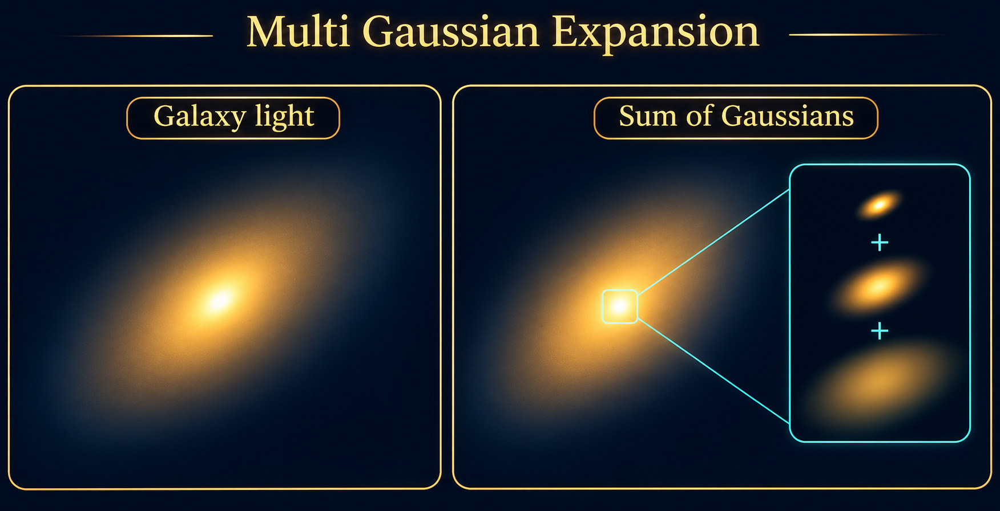
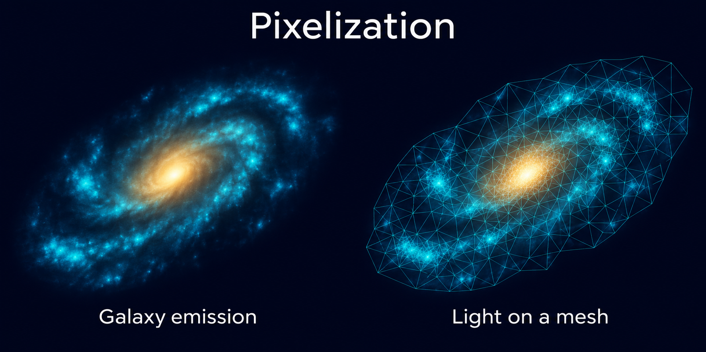
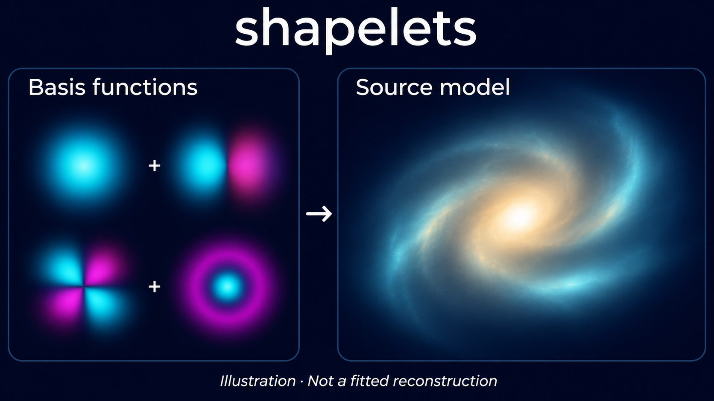
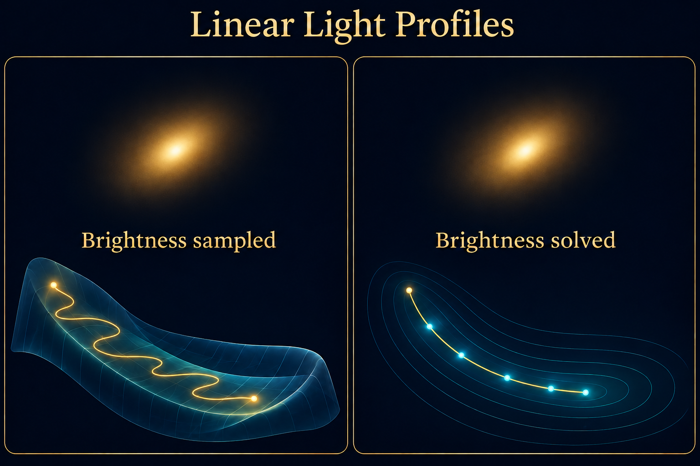
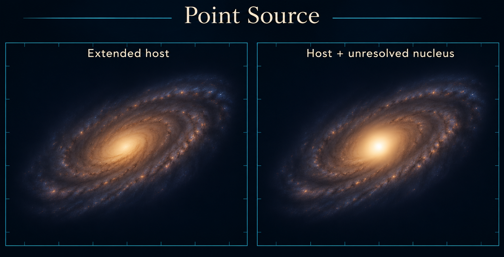
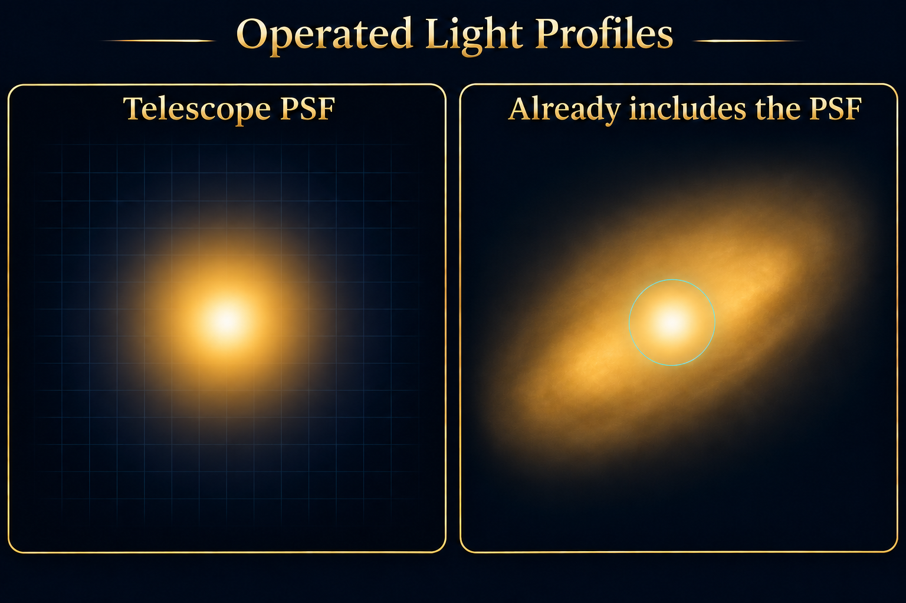
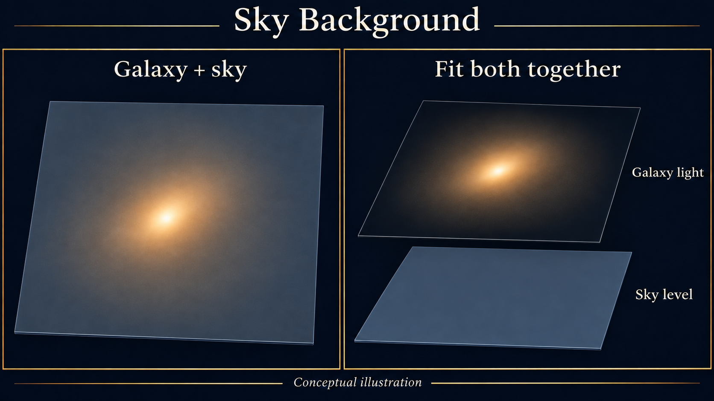

(overview-3-features)=

# Features

Explore the modelling tools you can add to your analysis. Each introduction explains the scientific use cases and links to worked examples.

For your first dataset and starting notebook, use the [New User Guide](https://autogalaxy.readthedocs.io/en/latest/overview/overview_2_new_user_guide.html).

<table class="feature-gallery"><tbody><tr><td width="25%"><a href="#multi-gaussian-expansion-mge"> MGE</a></td><td width="25%"><a href="#pixelizations"> Pixelizations</a></td><td width="25%"><a href="#shapelets"> Shapelets</a></td><td width="25%"><a href="#ellipse-fitting"> Ellipse Fitting</a></td></tr></tbody></table>

*Conceptual illustrations, not measured data or guaranteed reconstructions.*

More feature illustrations
<table class="feature-gallery"><tbody><tr><td width="25%"><a href="#linear-light-profiles"> Linear Light Profiles</a></td><td width="25%"><a href="#extra-galaxies"> Extra Galaxies</a></td><td width="25%"><a href="#point-source"> Point Source</a></td><td width="25%"><a href="#operated-light-profiles"> Operated Light Profiles</a></td></tr><tr><td width="25%"><a href="#sky-background"> Sky Background</a></td><td width="25%"><a href="#interferometry"> Interferometry</a></td><td width="25%"><a href="#multi-wavelength"> Multi-Wavelength</a></td></tr></tbody></table>

## Measure galaxy structure

<h3>Multi Gaussian Expansion (MGE)</h3>
Describe central and extended galaxy light with a sum of Gaussians. An MGE captures changes in shape with radius while solving component brightnesses together, providing a flexible alternative to a small set of light profiles.

<a href="https://github.com/PyAutoLabs/autogalaxy_workspace/blob/main/notebooks/imaging/features/multi_gaussian_expansion/start_here.ipynb">Explore multi gaussian expansion (mge)</a>.

<h3>Pixelizations</h3>
Reconstruct clumpy or asymmetric galaxy light on a mesh when a few analytic profiles are too restrictive. The data, mesh and regularization determine which structures can be recovered.

<a href="https://github.com/PyAutoLabs/autogalaxy_workspace/blob/main/notebooks/imaging/features/pixelization/start_here.ipynb">Start with pixelization</a>.

<h3>Shapelets</h3>
Study asymmetric morphology and structured residuals using a sum of spatial basis functions. Shapelet order, scale and geometry control the flexibility; assess the combined brightness distribution rather than treating individual basis modes as physical components.

<a href="https://github.com/PyAutoLabs/autogalaxy_workspace/blob/main/notebooks/imaging/features/shapelets/start_here.ipynb">Explore shapelets</a>.

<h3>Ellipse Fitting</h3>
Measure how a galaxy’s ellipticity, position angle and centre change with radius without imposing a radial light-profile law. Add multipoles to study lopsided or non-elliptical isophotes. This dedicated PyAutoGalaxy capability fits observed light; the examples do not convolve a light model with the PSF.

<a href="https://github.com/PyAutoLabs/autogalaxy_workspace/blob/main/notebooks/ellipse/fit.ipynb">Explore ellipse fitting</a>.

Continue to <a href="https://github.com/PyAutoLabs/autogalaxy_workspace/blob/main/notebooks/ellipse/modeling.ipynb">modeling</a> and <a href="https://github.com/PyAutoLabs/autogalaxy_workspace/blob/main/notebooks/ellipse/multipoles.ipynb">multipoles</a>.

## Separate light components

<h3>Linear Light Profiles</h3>
Fit galaxy geometry with fewer sampled parameters by solving component brightnesses together at each likelihood evaluation. This is especially useful for bulge–disc decomposition and models with many overlapping light components.

<a href="https://github.com/PyAutoLabs/autogalaxy_workspace/blob/main/notebooks/imaging/features/linear_light_profiles/start_here.ipynb">Explore linear light profiles</a>.

<h3>Extra Galaxies</h3>
Measure a target galaxy in a crowded field by fitting neighbouring light alongside it. Separating overlapping emission helps protect the inferred size, shape and flux of the target.

<a href="https://github.com/PyAutoLabs/autogalaxy_workspace/blob/main/notebooks/imaging/features/extra_galaxies/start_here.ipynb">Explore extra galaxies</a>.

<h3>Point Source</h3>
Simulate an unresolved nucleus inside an extended host galaxy. This example shows how compact and extended light combine after the instrumental response; it is a simulator, not a point-source fitting workflow.

<a href="https://github.com/PyAutoLabs/autogalaxy_workspace/blob/main/notebooks/imaging/features/point_source/start_here.ipynb">Explore point source</a>.

<h3>Operated Light Profiles</h3>
Separate compact nuclear emission from an extended host with a component that already includes the imaging PSF response. For interferometer data, the compact sky model is still transformed into visibilities.

<a href="https://github.com/PyAutoLabs/autogalaxy_workspace/blob/main/notebooks/imaging/features/operated_light_profile/start_here.ipynb">Explore operated light profiles</a>.

<h3>Sky Background</h3>
Measure faint galaxy outskirts while fitting an uncertain sky level alongside the galaxy light. The example fits a constant background; estimating its mean does not remove photon noise.

<a href="https://github.com/PyAutoLabs/autogalaxy_workspace/blob/main/notebooks/imaging/features/sky_background/start_here.ipynb">Explore sky background</a>.

## Combine observations and samples

<h3>Interferometry</h3>
Extend visibility modelling with MGE, shapelets or pixelized galaxy light to investigate complex emission.

<a href="https://github.com/PyAutoLabs/autogalaxy_workspace/tree/main/notebooks/interferometer/features">Interferometer features</a>.

<h3>Multi-Wavelength</h3>
Compare galaxy structure across bands and distinguish components such as a red bulge and blue disc, or stellar and dust emission. Fit datasets together with shared or wavelength-dependent parameters while preserving their individual responses and noise.

<a href="https://github.com/PyAutoLabs/autogalaxy_workspace/blob/main/notebooks/multi_dataset/start_here.ipynb">Explore multi-wavelength</a>.

<h3>Graphical Models</h3>
Infer population trends by fitting galaxy datasets with shared parameters. Hierarchical models describe distributions of properties such as size or Sersic index, helping study how galaxy structure varies with mass or redshift.

See the <a href="https://github.com/PyAutoLabs/autofit_workspace/tree/main/notebooks/features">PyAutoFit graphical-model examples</a> for the shared-parameter API.

<section class="directory" id="directory"><h2>All workspace links</h2>
Choose your dataset to browse every feature introduction.

Imaging · 8 introductions
<ul><li><a href="https://github.com/PyAutoLabs/autogalaxy_workspace/blob/main/notebooks/imaging/features/extra_galaxies/start_here.ipynb">Extra Galaxies</a></li><li><a href="https://github.com/PyAutoLabs/autogalaxy_workspace/blob/main/notebooks/imaging/features/linear_light_profiles/start_here.ipynb">Linear Light Profiles</a></li><li><a href="https://github.com/PyAutoLabs/autogalaxy_workspace/blob/main/notebooks/imaging/features/multi_gaussian_expansion/start_here.ipynb">Multi Gaussian Expansion</a></li><li><a href="https://github.com/PyAutoLabs/autogalaxy_workspace/blob/main/notebooks/imaging/features/operated_light_profile/start_here.ipynb">Operated Light Profile</a></li><li><a href="https://github.com/PyAutoLabs/autogalaxy_workspace/blob/main/notebooks/imaging/features/pixelization/start_here.ipynb">Pixelization</a></li><li><a href="https://github.com/PyAutoLabs/autogalaxy_workspace/blob/main/notebooks/imaging/features/point_source/start_here.ipynb">Point Source</a></li><li><a href="https://github.com/PyAutoLabs/autogalaxy_workspace/blob/main/notebooks/imaging/features/shapelets/start_here.ipynb">Shapelets</a></li><li><a href="https://github.com/PyAutoLabs/autogalaxy_workspace/blob/main/notebooks/imaging/features/sky_background/start_here.ipynb">Sky Background</a></li></ul>

Interferometer · 6 introductions
<ul><li><a href="https://github.com/PyAutoLabs/autogalaxy_workspace/blob/main/notebooks/interferometer/features/extra_galaxies/start_here.ipynb">Extra Galaxies</a></li><li><a href="https://github.com/PyAutoLabs/autogalaxy_workspace/blob/main/notebooks/interferometer/features/linear_light_profiles/start_here.ipynb">Linear Light Profiles</a></li><li><a href="https://github.com/PyAutoLabs/autogalaxy_workspace/blob/main/notebooks/interferometer/features/multi_gaussian_expansion/start_here.ipynb">Multi Gaussian Expansion</a></li><li><a href="https://github.com/PyAutoLabs/autogalaxy_workspace/blob/main/notebooks/interferometer/features/operated_light_profile/start_here.ipynb">Operated Light Profile</a></li><li><a href="https://github.com/PyAutoLabs/autogalaxy_workspace/blob/main/notebooks/interferometer/features/pixelization/start_here.ipynb">Pixelization</a></li><li><a href="https://github.com/PyAutoLabs/autogalaxy_workspace/blob/main/notebooks/interferometer/features/shapelets/start_here.ipynb">Shapelets</a></li></ul>

Multi dataset · 6 introductions
<ul><li><a href="https://github.com/PyAutoLabs/autogalaxy_workspace/blob/main/notebooks/multi_dataset/features/dataset_offsets/start_here.ipynb">Dataset Offsets</a></li><li><a href="https://github.com/PyAutoLabs/autogalaxy_workspace/blob/main/notebooks/multi_dataset/features/imaging_and_interferometer/start_here.ipynb">Imaging And Interferometer</a></li><li><a href="https://github.com/PyAutoLabs/autogalaxy_workspace/blob/main/notebooks/multi_dataset/features/one_by_one/start_here.ipynb">One By One</a></li><li><a href="https://github.com/PyAutoLabs/autogalaxy_workspace/blob/main/notebooks/multi_dataset/features/pixelization/start_here.ipynb">Pixelization</a></li><li><a href="https://github.com/PyAutoLabs/autogalaxy_workspace/blob/main/notebooks/multi_dataset/features/same_wavelength/start_here.ipynb">Same Wavelength</a></li><li><a href="https://github.com/PyAutoLabs/autogalaxy_workspace/blob/main/notebooks/multi_dataset/features/wavelength_dependence/start_here.ipynb">Wavelength Dependence</a></li></ul>

Multi galaxy · 1 introductions
<ul><li><a href="https://github.com/PyAutoLabs/autogalaxy_workspace/blob/main/notebooks/multi_galaxy/features/extra_galaxies/start_here.ipynb">Extra Galaxies</a></li></ul>
</section>